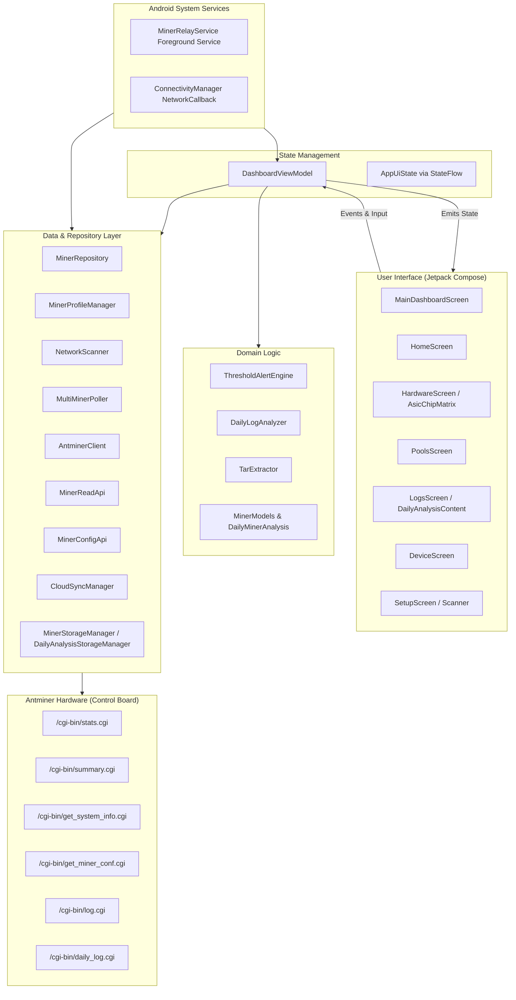

# Antminer Dashboard for Android ⛏️⚡

A native Android application built with **Kotlin**, **Jetpack Compose**, and **Material 3** for real-time monitoring, hardware diagnostics, pool management, log analysis, and batch onboarding of Bitmain Antminer ASIC hardware (S19, S19 Pro, S19j Pro, S19k Pro, T19, S21 series, L7, and compatible firmware).

Designed with an **offline-first, direct-hardware** architecture: the app communicates directly with Antminer control board microservices over local HTTP/CGI APIs without requiring third-party cloud intermediaries or proprietary mining management servers. It also features an optional background **Cloud Relay** engine for remote monitoring over cellular networks.

---

## 📑 Table of Contents

- [Key Features](#-key-features)
- [System Architecture](#-system-architecture)
- [Project Directory Structure](#-project-directory-structure)
- [Antminer CGI Protocol & Hardware API](#-antminer-cgi-protocol--hardware-api)
- [Core Functional Subsystems](#-core-functional-subsystems)
  - [1. Subnet Scanner & Batch Onboarding](#1-subnet-scanner--batch-onboarding)
  - [2. ASIC Chip Matrix & Hardware Telemetry](#2-asic-chip-matrix--hardware-telemetry)
  - [3. Daily Diagnostic Log Analyzer & Tar Pipeline](#3-daily-diagnostic-log-analyzer--tar-pipeline)
  - [4. Multi-Miner Poller & Hashrate Race](#4-multi-miner-poller--hashrate-race)
  - [5. Cloud Relay & Background Service](#5-cloud-relay--background-service)
  - [6. Threshold Alert Engine](#6-threshold-alert-engine)
- [UI & Screen Walkthrough](#-ui--screen-walkthrough)
- [Security & Network Configuration](#-security--network-configuration)
- [Build & Development Guide](#-build--development-guide)
- [Testing Suite](#-testing-suite)
- [Guide for AI Models & Developers](#-guide-for-ai-models--developers)

---

## 🚀 Key Features

* **Real-Time Telemetry Dashboard**: 5-second real-time and 24-hour moving average hashrates, inlet/outlet ambient temperatures, fan RPM gauges, power mode, and chain health status.
* **ASIC Chip-Level Matrix**: Visual interactive grid showing every individual ASIC chip per chain (`O` operational, `-` degraded/frequency-throttled, `X` unresponsive/dead).
* **Automated Subnet Scanner**:
  * Concurrent asynchronous IP sweep across `/24` subnets (up to 254 addresses) using Kotlin Coroutines and concurrency-limiting semaphores.
  * **Wi-Fi Gatekeeper**: Automatically enforces scanning only when connected to a local Wi-Fi network; gracefully disables local scanning on mobile data to prevent battery and cellular data exhaustion.
  * **Smart Deduplication & Badging**: Differentiates newly detected miners from existing fleet profiles using MAC address, worker name, or IP.
  * **Batch Onboarding**: One-click bulk credential verification and database addition of all discovered miners.
  * **DHCP Dynamic IP Self-Healing**: Automatically tracks and updates miner IP addresses when home or farm DHCP leases expire and change.
* **Stratum Pool Management**: Live accepted/rejected/stale share ratios, pool latency, active stratum connection status, and on-device pool configuration editing.
* **Raw & Diagnostic Log Analytics**:
  * Live kernel and mining daemon log streamer with real-time text search and log level filtering.
  * **Daily Diagnostic Log (.tar) Extractor**: In-memory and disk extraction of multi-day `.tar` Antminer diagnostic bundles, producing structured analytics (hashboard drops, high-temperature spikes, voltage anomalies, fan stalls).
* **Multi-Miner Farm Leaderboard ("Hashrate Race")**: Real-time comparative ranking of all configured miners in your mining farm.
* **Cloud Relay Background Service**: An optional foreground service (`MinerRelayService`) that periodically syncs miner telemetry snapshots to a user-configured Webhook or cloud endpoint for monitoring when away from the local Wi-Fi.
* **Modern Compose UI**: Edge-to-edge Material 3 layout, custom Antminer industrial styling (Antminer Emerald, Mining Gold, Alert Crimson), dark/light theme switching, and fluid touch interactions.

---

## 🏛️ System Architecture



The app follows the **MVI/MVVM pattern with Unidirectional Data Flow (UDF)**:
1. `DashboardViewModel` hosts a single `MutableStateFlow<AppUiState>`.
2. UI components are pure Compose functions observing `uiState.collectAsState()`.
3. User interactions call methods on `DashboardViewModel`.
4. Repositories communicate with low-level network drivers (`AntminerClient`, `NetworkScanner`) and emit updates back through coroutine flows.

---

## 📂 Project Directory Structure

```
d:/Project/Antminer Dashboard/
├── app/
│   ├── src/
│   │   ├── main/
│   │   │   ├── AndroidManifest.xml          # Permissions, foreground service, network security config
│   │   │   ├── java/com/example/antminerconnectiontest/
│   │   │   │   ├── MainActivity.kt          # Single-activity container, theme wrapper
│   │   │   │   ├── data/
│   │   │   │   │   ├── AntminerClient.kt    # OkHttpClient wrapper with Digest & Basic Auth
│   │   │   │   │   ├── analysis/            # Daily log diagnostic engine
│   │   │   │   │   │   ├── DailyLogAnalyzer.kt
│   │   │   │   │   │   └── TarExtractor.kt
│   │   │   │   │   ├── api/                 # Strongly-typed HTTP interfaces
│   │   │   │   │   │   ├── MinerReadApi.kt
│   │   │   │   │   │   └── MinerConfigApi.kt
│   │   │   │   │   ├── cloud/               # Remote webhook telemetry publisher
│   │   │   │   │   │   └── CloudSyncManager.kt
│   │   │   │   │   ├── parser/              # Robust JSON parsers handling firmware quirks
│   │   │   │   │   │   └── AntminerJsonParsers.kt
│   │   │   │   │   ├── repository/          # Repositories & fleet pollers
│   │   │   │   │   │   ├── MinerProfileManager.kt
│   │   │   │   │   │   ├── MinerRepository.kt
│   │   │   │   │   │   └── MultiMinerPoller.kt
│   │   │   │   │   ├── scanner/             # Subnet scanning & credential detector
│   │   │   │   │   │   └── NetworkScanner.kt
│   │   │   │   │   └── storage/             # SharedPreferences & file-backed caches
│   │   │   │   │       ├── DailyAnalysisStorageManager.kt
│   │   │   │   │       └── MinerStorageManager.kt
│   │   │   │   ├── domain/
│   │   │   │   │   ├── alerts/              # Health threshold checking engine
│   │   │   │   │   │   └── ThresholdAlertEngine.kt
│   │   │   │   │   └── model/               # Immutable domain data models
│   │   │   │   │       ├── CloudSyncModels.kt
│   │   │   │   │       ├── DailyMinerAnalysis.kt
│   │   │   │   │       └── MinerModels.kt
│   │   │   │   ├── service/                 # Background relay service
│   │   │   │   │   └── MinerRelayService.kt
│   │   │   │   ├── theme/                   # Material 3 colors, typography, theme definition
│   │   │   │   │   ├── Color.kt
│   │   │   │   │   ├── Theme.kt
│   │   │   │   │   └── Type.kt
│   │   │   │   └── ui/                      # Jetpack Compose UI screens & components
│   │   │   │       ├── components/          # Reusable Compose widgets
│   │   │   │       │   ├── AsicChipMatrix.kt
│   │   │   │       │   ├── CloudModeTabNotice.kt
│   │   │   │       │   ├── HashrateRaceCard.kt
│   │   │   │       │   ├── InteractiveHashrateChart.kt
│   │   │   │       │   ├── MinerRackCard.kt
│   │   │   │       │   ├── MinerSwitcherBottomSheet.kt
│   │   │   │       │   └── ShareHealthDonut.kt
│   │   │   │       ├── device/              # Device hardware specifications & actions
│   │   │   │       ├── hardware/            # Per-chain temps, chip grid, fan RPM
│   │   │   │       ├── home/                # Main overview dashboard
│   │   │   │       ├── logs/                # Real-time console log & Daily Analysis
│   │   │   │       ├── pools/               # Stratum pool status & configuration
│   │   │   │       ├── setup/               # Manual connect & Subnet Scanner
│   │   │   │       ├── ConnectionTestScreen.kt
│   │   │   │       ├── ConnectionTestViewModel.kt
│   │   │   │       ├── DashboardViewModel.kt
│   │   │   │       └── MainDashboardScreen.kt
│   │   │   └── res/                         # Android drawables, mipmaps, XML security rules
│   │   └── test/java/com/example/antminerconnectiontest/ # 34+ Unit tests
│   │       ├── data/analysis/DailyLogAnalysisPipelineTest.kt
│   │       ├── data/cloud/CloudSyncManagerTest.kt
│   │       ├── data/parser/AntminerJsonParsersTest.kt
│   │       ├── data/repository/MinerProfileManagerTest.kt
│   │       ├── domain/alerts/ThresholdAlertEngineTest.kt
│   │       ├── domain/model/RemoteMinerSnapshotTest.kt
│   │       └── ui/DashboardViewModelTest.kt
│   └── build.gradle.kts
├── gradle/                                  # Version catalog (libs.versions.toml) & wrapper
├── logs examples/                           # Reference Antminer diagnostic .tar sample archives
├── build.gradle.kts
├── settings.gradle.kts
└── README.md
```

---

## 📡 Antminer CGI Protocol & Hardware API

Bitmain Antminers host a lightweight web server (typically `lighttpd` or embedded daemon) running on port 80 (or 443 on newer TLS-enabled firmware). The dashboard interacts with these standardized endpoints:

| Endpoint | HTTP Method | Authentication | Description |
| :--- | :---: | :---: | :--- |
| `/cgi-bin/stats.cgi` | `GET` | Digest / Basic | Comprehensive telemetry: per-chain hashrate, chip state string, temperatures (PCB/chip), fan RPMs. |
| `/cgi-bin/summary.cgi` | `GET` | Digest / Basic | High-level summary: 5s hashrate, average hashrate, total elapsed uptime, accepted/rejected difficulty. |
| `/cgi-bin/get_system_info.cgi`| `GET` | Digest / Basic | Hardware architecture, system worker name, control board MAC address, firmware release date, kernel version. |
| `/cgi-bin/get_miner_conf.cgi` | `GET` | Digest / Basic | Current pool addresses (Pool 1, 2, 3), worker IDs, passwords, voltage/frequency scaling profiles. |
| `/cgi-bin/set_miner_conf.cgi` | `POST`| Digest / Basic | Modifies stratum pool configuration and restarts mining subroutines. |
| `/cgi-bin/log.cgi` | `GET` | Digest / Basic | Real-time dump of `dmesg`, kernel boot log, and running `cgminer` output. |
| `/cgi-bin/daily_log.cgi` | `GET` | Digest / Basic | Lists and downloads multi-day tarball diagnostic archives (`.tar`). |
| `/cgi-bin/reboot.cgi` | `POST`| Digest / Basic | Issues hardware-level reboot to the control board. |

### Firmware Normalization Layer
Different generations of Antminer firmware (Stock Bitmain OpenWrt, newer Xilinx / BeagleBone / Amlogic Linux variants, Braiins OS, and Vnish) return JSON with slight structural discrepancies (e.g., numbers represented as strings, variable chain keys `CHAIN[1]` vs `devs[0]`, missing fields). 

`AntminerJsonParsers.kt` acts as a **fault-tolerant normalization layer**:
- Safely converts polymorphic JSON types (strings, doubles, nulls).
- Extracts chip bitmasks regardless of whether chips are reported as 120-character ASCII strings (`"ooooo-xxx"`) or nested JSON objects.
- Recovers gracefully when non-standard firmware omits system summary blocks.

---

## ⚙️ Core Functional Subsystems

### 1. Subnet Scanner & Batch Onboarding
Located in `data/scanner/NetworkScanner.kt`:
* **Subnet Resolution**: Inspects the active Wi-Fi network interface to determine the local IPv4 address and CIDR subnet (defaults to `/24` e.g., `192.168.1.0/24`).
* **Concurrency Control**: Concurrently probes target IPs using a coroutine `Semaphore(10)` to prevent TCP connection table exhaustion on home routers.
* **Smart Identity & Auto-Healing**:
  * Each discovered miner is checked against saved profiles using **Worker Name**, **MAC Address**, or **IP Address**.
  * If a miner's IP changed due to DHCP lease expiration, opening it immediately triggers auto-healing (`profileManager.saveOrUpdateProfile(existing.copy(host = newIp))`), maintaining historical data and favorites seamlessly.
* **Batch Verification**: `connectAllDiscoveredMiners` executes concurrent credential checks across all unadded miners with real-time atomic progress counters (`AtomicInteger`), saving verified miners to persistent storage in a single operation.

### 2. ASIC Chip Matrix & Hardware Telemetry
Located in `ui/components/AsicChipMatrix.kt` and `ui/hardware/HardwareScreen.kt`:
* **Matrix Visualizer**: Renders the exact physical chip topology for each hashboard.
  * 🟢 **`O` (Green)**: Chip responding normally at full clock speed.
  * 🟡 **`-` (Yellow)**: Throttled or sub-frequency chip.
  * 🔴 **`X` (Red)**: Dead, unresponsive, or missing ASIC.
* **Thermal Sensors**: Monitors inlet (ambient) vs outlet (exhaust) temperatures across all hashboards, highlighting thermal differentials that indicate heat-sink detachment or airflow blockage.
* **Fan Tachometers**: Real-time RPM readout for Fan 1, Fan 2, Fan 3, and Fan 4 with alert thresholds below 2,500 RPM.

### 3. Daily Diagnostic Log Analyzer & Tar Pipeline
Located in `data/analysis/DailyLogAnalyzer.kt` and `data/analysis/TarExtractor.kt`:
* Antminers produce `.tar` bundles containing system snapshots (`messages`, `cgminer`, `soc_temp`, `dmesg`).
* The in-app **TarExtractor** uncompresses and parses these archives directly on device without native library dependencies.
* The **DailyLogAnalyzer** scans for:
  * **Hashboard Drops**: Chain failure events where a board stopped hashing mid-operation.
  * **Thermal Outliers**: Sustained high-temp spikes triggering emergency throttle.
  * **Hardware Errors (HW Error Spikes)**: Excessive nonce recalculations.
  * **Network Stratum Disconnects**: High pool latency or DNS resolution failures.

### 4. Multi-Miner Poller & Hashrate Race
Located in `data/repository/MultiMinerPoller.kt`:
* Polls all saved miner profiles in the background while the app is active and connected to Wi-Fi.
* Maintains real-time hashrate standings ("Hashrate Race"), displaying a leaderboard that compares relative performance across the entire fleet.

### 5. Cloud Relay & Background Service
Located in `data/cloud/CloudSyncManager.kt` and `service/MinerRelayService.kt`:
* When enabled, the app acts as an edge node:
  * Collects local miner telemetry snapshots.
  * Posts encrypted JSON payloads to a custom Webhook URL (e.g., Discord webhook, custom backend, Telegram bot gateway, or Home Assistant).
  * Runs as an Android Foreground Service with a persistent notification, ensuring continuous remote monitoring even when the user leaves the application.

### 6. Threshold Alert Engine
Located in `domain/alerts/ThresholdAlertEngine.kt`:
Evaluates live telemetry against critical thresholds and emits actionable alerts:
- ⚠️ **High Chip Temperature**: > 85°C (Warning), > 90°C (Critical Emergency Shutdown Imminent).
- ⚠️ **Fan Failure**: Fan speed drops below 2,500 RPM or reports 0 RPM.
- ⚠️ **Hashrate Degradation**: Output falls below 80% of nominal advertised rating.
- ⚠️ **Missing Chain / Board Offline**: Less than expected operational chains detected.
- ⚠️ **Pool Stale Rate**: Rejected shares exceed 2% over an evaluation window.

---

## 📱 UI & Screen Walkthrough

| Screen | Description |
| :--- | :--- |
| **Home Tab** | High-level operations center showing active miner hashrate, 5s vs 24h average, active alerts, pool connection indicator, and the Hashrate Race leaderboard. |
| **Hardware Tab** | In-depth hardware telemetry: fan tachometer gauges, intake/exhaust temperatures per chain, and the interactive chip-by-chip ASIC matrix. |
| **Pools Tab** | Live Stratum pool connections, active pool marker, accepted/rejected/stale shares chart, pool latency, and form to edit and push new pool URLs/credentials. |
| **Logs Tab** | Dual-mode logging interface: (1) Live interactive log viewer with auto-scroll and regex search; (2) Daily Diagnostic Analysis viewer detailing historical hardware events. |
| **Device Tab** | Control board specifications, firmware builds, network configurations, remote reboot command trigger, and miner nickname/location editor. |
| **Setup & Scanner** | Manual IP connection form alongside the automated subnet scanner with Wi-Fi network detection, smart badges (`✓ ADDED`), and one-click "Connect All". |

---

## 🔒 Security & Network Configuration

### Cleartext Traffic (`network_security_config.xml`)
Antminer web servers on older and stock firmware do not support HTTPS/TLS and use plain HTTP on port 80. The app configures targeted network security rules:
- Cleartext HTTP is permitted specifically for local RFC-1918 subnets (`192.168.0.0/16`, `10.0.0.0/8`, `172.16.0.0/12`).
- Webhook uploads for Cloud Relay are strictly enforced over HTTPS.

### Wi-Fi Subnet Enforcement
To avoid sending local broadcast or subnet probes over cellular radio (which fails, causes carrier timeouts, and drains battery), the scanner queries Android's `ConnectivityManager`:
```kotlin
val cm = context.getSystemService(ConnectivityManager::class.java)
val capabilities = cm.getNetworkCapabilities(cm.activeNetwork)
val isWifi = capabilities?.hasTransport(NetworkCapabilities.TRANSPORT_WIFI) == true
```
If not on Wi-Fi, scanning is automatically gated with a descriptive standby banner.

---

## 🛠️ Build & Development Guide

### Prerequisites
- **Android Studio**: Jellyfish (2023.3.1) or newer / Ladybug.
- **JDK**: Java 17 or Java 21.
- **Android SDK**: `minSdk = 26` (Android 8.0 Oreo), `targetSdk = 34` (Android 14).
- **Gradle Wrapper**: 9.1.0 (configured with Kotlin 2.0.21 / AGP 8.7.3).

### Building from Source

1. **Clone the Repository**:
   ```bash
   git clone https://github.com/banishwor/antminer-android.git
   cd antminer-android
   ```

2. **Assemble Debug APK**:
   ```powershell
   ./gradlew assembleDebug
   ```
   The compiled APK will be generated at:
   `app/build/outputs/apk/debug/app-debug.apk`

3. **Install on Connected Android Device or Emulator**:
   ```powershell
   ./gradlew installDebug
   ```

---

## 🧪 Testing Suite

The repository includes a comprehensive unit test suite in `app/src/test/` verifying critical parsing, network scanning, and diagnostic analysis logic:

```powershell
./gradlew testDebugUnitTest
```

### Key Test Suites:
- **`DailyLogAnalysisPipelineTest`**: Tests `.tar` unpacking, directory traversal, and diagnostic report generation against real Antminer log data.
- **`AntminerJsonParsersTest`**: Validates JSON deserialization across 8 distinct firmware versions and edge cases (corrupt JSON, missing fields, string-wrapped numbers).
- **`NetworkScannerTest` / `DashboardViewModelTest`**: Tests Wi-Fi network gatekeeping, DHCP IP self-healing, smart identity matching, and batch connection flow.
- **`ThresholdAlertEngineTest`**: Verifies exact thermal, fan, and hashrate warning thresholds.
- **`CloudSyncManagerTest`**: Tests payload serialization and webhook delivery logic.

---

## 🤖 Guide for AI Models & Developers

When extending or maintaining this codebase, adhere to these core architectural principles:

1. **Maintain Immutability in State**:
   - `AppUiState` in `DashboardViewModel.kt` is the single source of truth for UI state. Never mutate fields directly; always use `_uiState.update { it.copy(...) }`.
2. **Preserve Network Thread Safety**:
   - All network calls (`AntminerClient`, `NetworkScanner`, `CloudSyncManager`) must execute on `Dispatchers.IO`.
   - Never block the Compose main thread with socket reads or JSON parsing.
3. **Firmware Polymoiphism**:
   - When introducing support for newer miners (e.g., S21 Hydro, Antminer T21, or custom hydro firmware), update `AntminerJsonParsers.kt` rather than modifying UI components. UI components must remain agnostic to firmware differences.
4. **Offline-First & Privacy**:
   - Never introduce required external cloud dependencies for local functionality. Local features must work on completely isolated/air-gapped mining LANs without internet access.
5. **Thread-Safe Concurrency**:
   - Use `java.util.concurrent.atomic.AtomicInteger` and `kotlinx.coroutines.sync.Semaphore` when implementing batch operations across multiple hardware units to prevent race conditions.

---

## 📄 License

This project is licensed under the [MIT License](LICENSE).
Feel free to use, modify, and distribute this software for personal or commercial cryptocurrency mining operations.
